# 备案通过之后：给 Halo 博客绑上 feeailab.cn、开 HTTPS、挂备案号的完整记录

> 📖 原文：[飞飞AI实验室 · 博客原文](https://feeailab.cn/archives/icp-domain-https-halo)　｜　博客：[feeailab.cn](https://feeailab.cn)　｜　环境：阿里云 ECS + 1Panel + Halo

> 2026 年 11 月 10 日（北京时间），我的域名 feeailab.cn 备案通过了。本以为备案一过网站就能打开，结果从“管局审核通过”到浏览器里真正出现 `https://feeailab.cn`，中间还有解析、绑定、证书、外部地址、页脚备案号五件事要做，外加一个让我虚惊一场的手机报错。这篇把完整步骤、命令和踩过的坑都记下来，给同样用 **阿里云 ECS + 1Panel + Halo** 建站的朋友做个参考。

先交代一下环境：

| 项目 | 情况 |
|---|---|
| 服务器 | 阿里云 ECS（杭州），2 核 2G，Ubuntu 22.04 |
| 面板 / 网关 | 1Panel，OpenResty 做反向代理 |
| 博客 | Halo 2.27.1（Docker 部署，监听 `127.0.0.1:8091`），数据库 PostgreSQL |
| 主题 | Serenity |
| 域名 | feeailab.cn，2026-11-02 在阿里云购买，30 元/年 |
| 备案前的访问方式 | 只能用 IP：`http://47.118.49.52` |

我的目标很明确：

1. 确认备案真的通过了；
2. 让 `feeailab.cn` 和 `www.feeailab.cn` 都能访问博客；
3. 全站 HTTPS，http 自动跳转到 https；
4. Halo 生成的文章链接从 IP 换成域名；
5. 网站底部挂上备案号，并链接到工信部网站。

部分操作借助 AI 助手完成，下面按我实际的顺序来写。

---

## 一、备案状态怎么查

### 1. 打开备案控制台

登录阿里云，进入 **ICP 备案控制台 → 我的备案**。我这次打开时控制台登录已经过期，用阿里云 App 扫码重新登录就好了。

在订单列表里找到这次的备案订单，重点看三项：

- **类型**：无主体新增服务（在已有备案主体下，为新网站和新域名增加服务）；
- **当前进度**：**管局审核通过**；
- **创建时间**：2026-11-03 10:21。

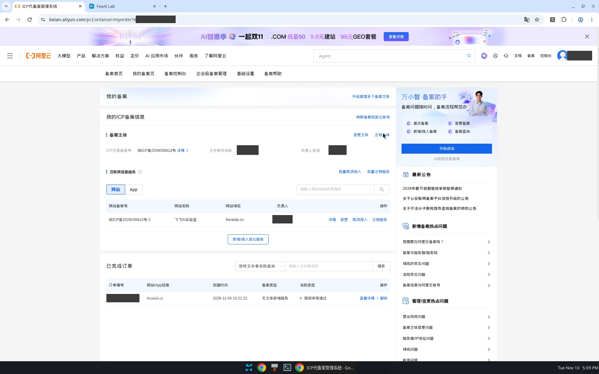

### 2. 记下网站备案号

同一个页面的“互联网信息服务 → 网站”列表里，能看到网站信息（上图中间那一行）：

- 网站名称：飞飞AI实验室
- 网站域名：feeailab.cn
- 网站备案号：**皖ICP备2026035613号-2**

这里有个小细节：备案号末尾的 `-2` 表示这是该主体下的第 2 个网站。**页脚要挂的是带 `-N` 后缀的“网站备案号”**，不是不带后缀的主体备案号。

> 截图发出来之前，记得把主体姓名、证件号、订单号这些个人信息打码。

---

## 二、添加域名解析

备案通过只代表“这个域名可以在国内服务器上合法提供服务”，**并不会自动帮你指向服务器**。我一查，feeailab.cn 根本没有任何 A 记录。

### 1. 先看现状

域名的 NS 是阿里云默认的 `dns13.hichina.com / dns14.hichina.com`，所以直接在阿里云云解析里加记录就行。查解析我推荐用公共 DoH 接口，不受本机网络影响：

```bash
# 查 NS
curl -s "https://dns.alidns.com/resolve?name=feeailab.cn&type=NS"
# 查 A 记录
curl -s "https://dns.alidns.com/resolve?name=feeailab.cn&type=A"
curl -s "https://dns.alidns.com/resolve?name=www.feeailab.cn&type=A"
```

当时 A 记录查不到结果，确认需要新增。

### 2. 在云解析 DNS 里加两条 A 记录

进入 **云解析 DNS → 域名解析 → feeailab.cn → 解析设置 → 添加记录**：

| 记录类型 | 主机记录 | 记录值 | TTL |
|---|---|---|---|
| A | `@` | 47.118.49.52 | 10 分钟 |
| A | `www` | 47.118.49.52 | 10 分钟 |

`@` 代表裸域 `feeailab.cn`，`www` 代表 `www.feeailab.cn`。两条都要加，不然有人习惯性敲 `www.` 就打不开。

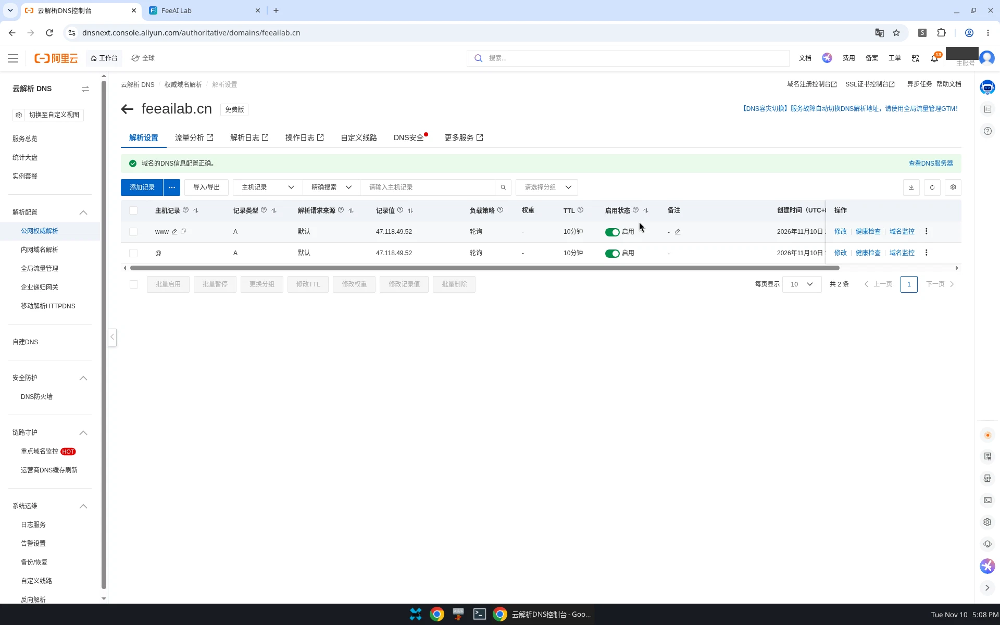

### 3. 验证解析生效

几分钟后再用 DoH 查一次，两个名字都返回了服务器 IP：

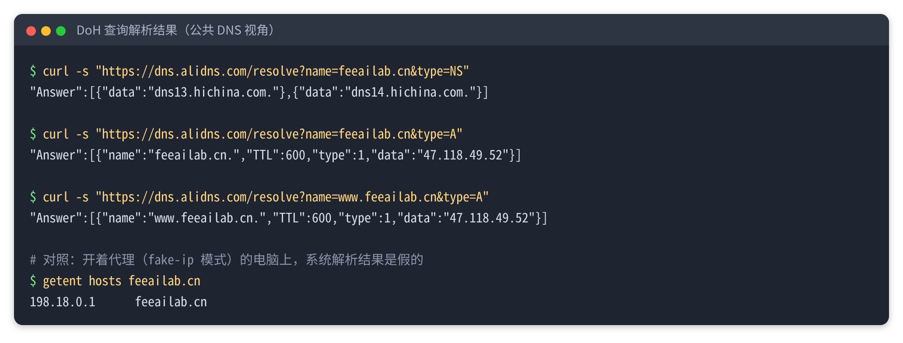

注意图里最后一段：**我的电脑开着代理（fake-ip 模式），系统解析出来的是 `198.18.0.1`**，这是代理软件分配的假地址，不代表真实解析。所以如果你本机也开着代理，`ping` 和 `nslookup` 的结果都别全信，改用 DoH 或下面这种绕过解析的写法：

```bash
# 不管本机 DNS 怎么解析，强制把域名指向服务器 IP 来测试
curl -I --resolve feeailab.cn:80:47.118.49.52 http://feeailab.cn
```

还有一个小插曲：刚加完记录时，我查 `www.feeailab.cn` 有一次得到“域名不存在”，过一会儿再查就正常了。这是公共 DNS 节点缓存了加记录之前的“不存在”结果，等缓存过期就好。**刚加的解析，不同网络、不同 DNS 节点生效的时间不一样**，后面手机上的问题也和这个有关。

---

## 三、在 1Panel 里绑定域名、申请证书、强制 HTTPS

之前在 1Panel 建的反向代理网站 `halo`，域名只填了 `47.118.49.52:80`，所以用域名访问是对不上的。

### 1. 添加域名

**1Panel → 网站 → 网站 → halo → 配置 → 域名设置 → 添加**，加入：

- `feeailab.cn`（设为主域名）
- `www.feeailab.cn`

保存后 1Panel 会把它们写进 OpenResty 的 `server_name`。

### 2. 申请 Let's Encrypt 证书

**1Panel → 网站 → 证书 → 申请证书**：

- 主域名：`feeailab.cn`，其他域名：`www.feeailab.cn`；
- 验证方式：**HTTP 验证**（HTTP-01）。前提是解析已生效、80 端口能从公网访问，所以一定要先做第二步；
- Acme 账户：用已有的账户就行；
- 勾选 **自动续签**。

申请成功后，证书有效期是 **2026-11-10 15:29 至 2027-02-08 15:29（北京时间）**。Let's Encrypt 证书只有 90 天，所以自动续签一定要开。

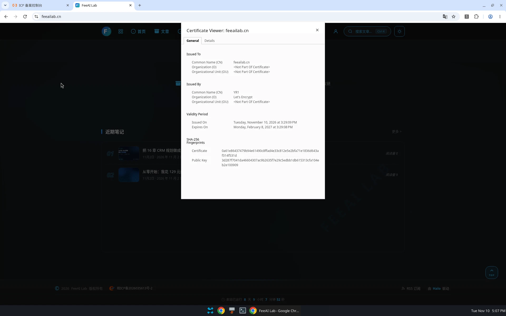

### 3. 开启 HTTPS 并强制跳转

回到 **网站 → halo → 配置 → HTTPS**：

- 启用 HTTPS，选择刚申请的证书；
- HTTP 选项选 **强制 HTTPS**（http 自动 301 到 https）；
- 协议保留 **TLSv1.2 / TLSv1.3**；
- 开启 **HSTS**。

保存前确认 443 端口已经放行。我的服务器之前已经在阿里云安全组和 1Panel 防火墙里开了 443，这一步没卡住。如果你没开，记得两边都要放行。

### 4. 看一眼生成的配置

1Panel 改完，OpenResty 配置大致是这样（只保留关键行）：

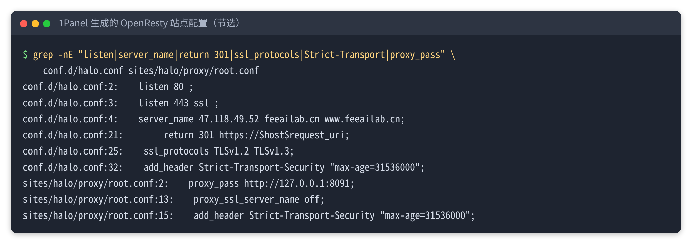

能看到这几点：

- `server_name` 里有两个域名（之前的 IP 也还在）；
- `if ($scheme = http) { return 301 https://$host$request_uri; }` 就是强制 HTTPS；
- 反向代理仍然指向 Halo 容器的 `127.0.0.1:8091`。

想自己核对的话，可以在服务器上执行：

```bash
cd /opt/1panel/www
grep -nE "listen|server_name|return 301|ssl_protocols|Strict-Transport|proxy_pass" \
  conf.d/halo.conf sites/halo/proxy/root.conf
```

---

## 四、修改 Halo 的外部访问地址

到这一步，用域名已经能打开博客了，但还差一件很容易忘的事：**Halo 的外部访问地址还是 `http://47.118.49.52`**。不改的话，文章的 canonical 链接、分享卡片、RSS、站点地图里的地址都还是 IP。

我的 Halo 是用 docker-compose 部署的，外部地址写在启动参数里，所以要改两处。

### 1. 改 docker-compose 启动参数

```bash
cd /opt/halo
# 先备份，出问题可以一键还原
cp docker-compose.yml docker-compose.yml.bak-20261110

# 找到这一行
grep -n "external-url" docker-compose.yml
#  - --halo.external-url=http://47.118.49.52
# 改成
#  - --halo.external-url=https://feeailab.cn

# 重建容器使参数生效（注意不是 restart）
docker compose up -d

# 等容器变成 healthy
docker ps --format "{{.Names}}  {{.Image}}  {{.Status}}"
```

这里有一个坑：**改了 compose 里的参数，`docker restart halo` 是不会生效的**，restart 只是用旧配置重启同一个容器。必须 `docker compose up -d`，让它按新配置重建容器。数据都在挂载的目录和 PostgreSQL 里，重建不会丢。

### 2. 后台里也改一下

登录 Halo 后台，**设置 → 基本设置 → 外部访问地址**，改成 `https://feeailab.cn` 并保存。

### 3. 验证

打开任意一篇文章，查看源码里的 canonical 和 og:url：

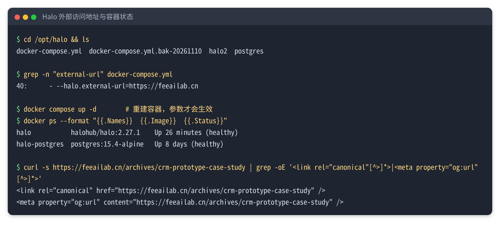

两个地址都变成了 `https://feeailab.cn/archives/...`，说明改好了。

---

## 五、在页脚挂上备案号

备案通过后，网站首页底部要展示网站备案号，并链接到工信部备案管理系统 `https://beian.miit.gov.cn/`。

我用的 Serenity 主题自带这项设置，不用改代码，也不用往页脚注入 HTML：

**Halo 后台 → 外观 → 主题 → 设置（当前主题 Serenity）→ 页脚**：

- 打开 **显示 ICP 备案**；
- 备案号：`皖ICP备2026035613号-2`；
- 链接：`https://beian.miit.gov.cn/`；
- 保存。

如果你的主题没有这个选项，可以在 **设置 → 代码注入 → 页脚** 里自己加一行链接。

刷新首页，页脚左下角就出现了备案号，点击会跳到工信部网站：

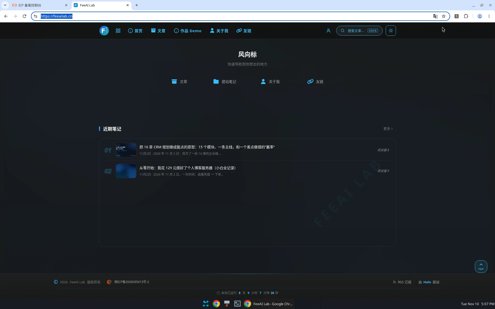

一个经验：**动配置之前先备份**。不管是改 compose 文件、主题设置还是数据库，留一份备份，改错了随时能退回去。

---

## 六、整体验证

所有配置做完，我用下面几组命令做了一遍完整检查。为了不受本机代理的影响，统一加了 `--resolve`：

```bash
R="--resolve feeailab.cn:80:47.118.49.52 --resolve feeailab.cn:443:47.118.49.52 \
   --resolve www.feeailab.cn:80:47.118.49.52 --resolve www.feeailab.cn:443:47.118.49.52"

# 1) http 是否 301 到 https
curl -sI $R http://feeailab.cn
curl -sI $R http://www.feeailab.cn

# 2) https 是否 HTTP/2 200，证书校验是否通过（0 = 通过）
curl -s $R -o /dev/null -w '%{http_version} %{http_code} %{ssl_verify_result}\n' https://feeailab.cn/
curl -s $R -o /dev/null -w '%{http_version} %{http_code} %{ssl_verify_result}\n' https://www.feeailab.cn/

# 3) 证书签发方、有效期、覆盖的域名
echo | openssl s_client -connect 47.118.49.52:443 -servername feeailab.cn 2>/dev/null \
  | openssl x509 -noout -issuer -subject -dates -ext subjectAltName
```

结果：

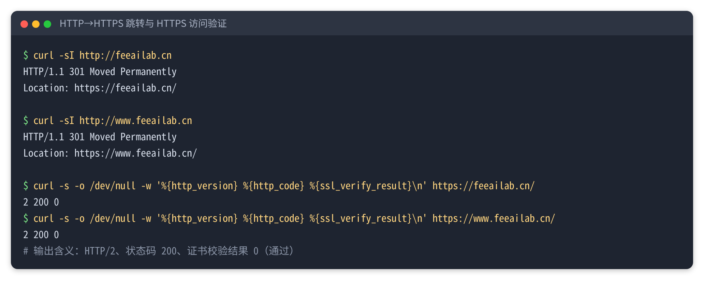

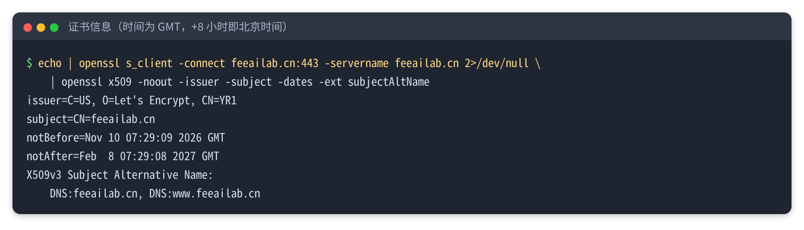

> 小提示：用 `curl -I`（HEAD 请求）直接访问 Halo 的 https 首页，我这里返回的是 404，用普通 GET 请求才是 200。所以判断首页能不能打开，用上面 `-o /dev/null -w` 的写法更准确。

最后在浏览器里直接输入 `http://feeailab.cn`，地址栏自动变成 `https://feeailab.cn`，首页正常显示：

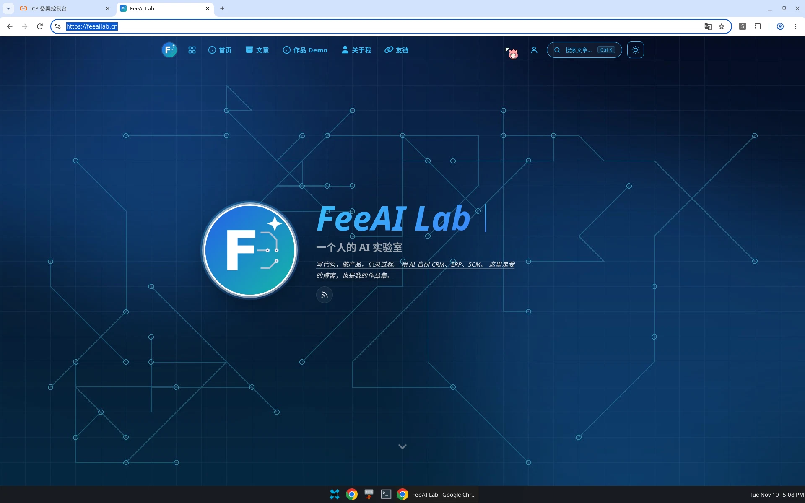

---

## 七、踩坑与经验

### 坑 1：备案成功 ≠ 网站能访问

备案只是“准入”。要真正能用域名访问，还得：**加解析 → 网站绑定域名 → 申请证书 → 开 HTTPS → 改外部地址 → 挂备案号**。我一开始以为备案通过就完事了，结果一查连 A 记录都没有。

### 坑 2：开了强制 HTTPS 后，用 IP 访问会失败

证书只签给了 `feeailab.cn` 和 `www.feeailab.cn`，IP 不在证书里。开启强制 HTTPS 后，输入 `http://47.118.49.52` 会被跳到 `https://47.118.49.52`，浏览器就会报证书错误。**以后一律用域名访问**，后台也用域名登录。

### 坑 3：手机上 www 能打开，裸域却报 ERR_SSL_PROTOCOL_ERROR

这是今天最让我紧张的一下。配置刚做完，我在 iPhone 的 Chrome 里打开：

- `https://www.feeailab.cn`：正常打开，图片和样式都加载出来了；
- `https://feeailab.cn`：报“此网站无法提供安全连接，ERR_SSL_PROTOCOL_ERROR”。

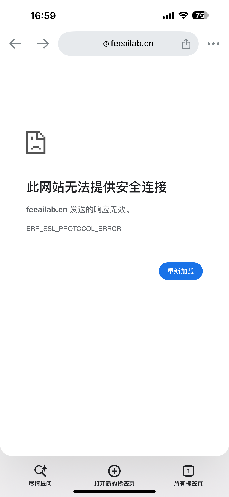

第一反应是证书配错了，但排查下来服务器没问题：

1. 从别的网络用 `curl --resolve` 访问 `https://feeailab.cn`，返回 200，证书有效，SAN 里也包含裸域；
2. 看服务器的访问日志，**手机访问 www 的请求都在，访问裸域的那次请求根本没有到达服务器**。

```bash
# 在服务器上实时看访问日志，然后用手机再打开一次
tail -f /opt/1panel/www/sites/halo/log/access.log
```

请求没到服务器，就说明问题出在手机这一侧：解析刚加不久，很可能是手机所在网络的 DNS 还缓存着旧结果，或者被代理之类的东西拦截，连接没有到达我的服务器，SSL 握手自然失败。

处理方法：

- 先用 `www.feeailab.cn` 访问；
- 关掉这个标签页，新开一个再试；
- 在 Wi‑Fi 和流量之间切换一次，或开关一次飞行模式；
- 如果开着 VPN 或代理，先关掉；
- 实在不行就等一等，一般十几分钟到一两个小时会自己恢复。

**经验：遇到“有人打不开、有人能打开”，先看服务器访问日志里有没有这次请求。** 有，就查服务器；没有，就是客户端网络或 DNS 的问题，别急着改服务器配置。

### 坑 4：外部访问地址不改，链接还是 IP

域名能打开不代表 Halo 知道自己换了域名。不改外部访问地址，文章 canonical、分享链接、RSS、sitemap 都还会带着 IP。

### 坑 5：改 compose 参数要 `up -d`，不是 `restart`

`docker restart` 不会读取新的 compose 配置。改完参数要 `docker compose up -d` 重建容器，然后等状态变成 `healthy` 再验证。

### 坑 6：备案号要挂，公安备案别忘了

- 网站底部展示网站备案号并链接到 `https://beian.miit.gov.cn/`，是工信部备案的要求；
- **公安联网备案**是另一套流程，一般要求在网站开通后 30 日内到全国互联网安全管理服务平台办理。具体要求以当地公安机关和平台说明为准，我也准备接下来去看一下。

---

## 八、上线检查清单

| # | 检查项 | 怎么做 / 怎么验证 | 状态 |
|---|---|---|---|
| 1 | 备案状态 | 阿里云备案控制台 → 我的备案，进度为“管局审核通过” | ✅ |
| 2 | 记下网站备案号 | 订单详情 → 网站信息，带 `-N` 后缀的那个 | ✅ |
| 3 | A 记录 `@` | 云解析 DNS 添加，DoH 查询返回服务器 IP | ✅ |
| 4 | A 记录 `www` | 同上 | ✅ |
| 5 | 80 / 443 端口 | 安全组和 1Panel 防火墙都放行 | ✅ |
| 6 | 网站绑定域名 | 1Panel 网站 → 域名设置，加入两个域名 | ✅ |
| 7 | SSL 证书 | Let's Encrypt，HTTP 验证，开启自动续签 | ✅ |
| 8 | 强制 HTTPS | `curl -I http://...` 返回 301 到 https | ✅ |
| 9 | HTTPS 可用 | `-w '%{http_version} %{http_code}'` 返回 `2 200` | ✅ |
| 10 | 证书覆盖两个域名 | `openssl x509 -ext subjectAltName` | ✅ |
| 11 | Halo 外部访问地址 | compose 参数 + 后台基本设置，canonical / og:url 为新域名 | ✅ |
| 12 | 页脚备案号 | 主题设置 → 页脚，链接到 beian.miit.gov.cn | ✅ |
| 13 | 多端实测 | 手机和电脑各打开一次两个域名 | ✅（手机上裸域刚开始报错，见坑 3） |
| 14 | www 跳转到裸域 | 可选 | ⏳ |
| 15 | 公安联网备案 | 网站开通后 30 日内办理 | ⏳ |

---

## 九、后续计划

1. **统一入口**：现在 `www.feeailab.cn` 和 `feeailab.cn` 是两个都能打开的地址，打算把 `www` 301 跳转到裸域，避免同一篇文章有两个网址。
2. **公安联网备案**：按要求在开通后 30 日内办好，拿到公安备案号后同样挂到页脚。
3. **续费提醒**：域名一年一续，证书虽然会自动续签，但我会在到期前（2027 年 2 月初）上服务器确认一次续签成功。

从备案通过到博客用上 `https://feeailab.cn`，真正动手的时间不长，花时间的主要是验证和排查那个手机报错。希望这份记录能帮你少走点弯路。
